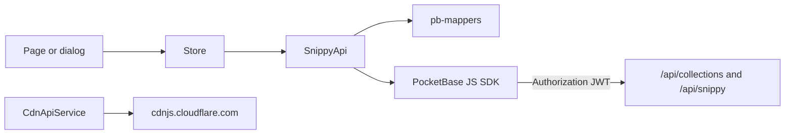

# Snippy frontend

Angular 22 standalone SPA in [`snippy/frontend`](../snippy/frontend). There is **no Node/Express API**. The browser talks to **PocketBase** (auth, SQLite, files, collection rules, hooks) through a same-origin proxy on `/api/`. Production nginx does not proxy the Admin UI. `/_/` is the OAuth popup close page.

Signals hold domain state. Angular Material + Tailwind draw chrome. The [PocketBase JS SDK](https://github.com/pocketbase/js-sdk) is the only backend client, except cdnjs for extra CSS/JS libraries.

Route screens live under `src/app/pages/`. Reusable UI lives under `src/app/components/`. Those folders are self-explanatory; this guide covers the layers underneath.

Related: [PocketBase collections and rules](db.md) · [self-host README](../README.md)

## Table of contents

- [Request flow](#request-flow)
- [Runtime env](#runtime-env)
- [PocketBase URLs, JWT, and access](#pocketbase-urls-jwt-and-access)
- [Models](#models)
- [Interfaces](#interfaces)
- [Guards](#guards)
- [Editor](#editor)
- [Utils](#utils)
- [Services](#services)
  - [api](#api)
  - [data](#data)
  - [stores](#stores)
  - [ui](#ui)
- [Extending](#extending)

---

## Request flow

Dev: [`proxy.conf.js`](../snippy/frontend/proxy.conf.js) forwards `/api` and `/_/` to PocketBase (`http://127.0.0.1:8090`, or `POCKETBASE_PROXY_TARGET` inside Compose). `ng serve` loads it from `angular.json`. The Admin UI is still the PocketBase process.

Prod: [`nginx.site.conf`](../snippy/frontend/nginx.site.conf) forwards `/api/` only. `/_/` is not the Admin UI. PocketBase sends the OAuth popup there to close it, so nginx serves [`oauth2-popup-close.html`](../snippy/frontend/public/oauth2-popup-close.html) for that path. The Admin UI stays on `127.0.0.1:8090/_/`. CSP `connect-src` is `'self' blob: data:` plus `https://api.cdnjs.com` and `https://cdnjs.cloudflare.com`. The app `script-src` is `'self'` only: no inline scripts, no `eval`, no third-party script. `index.html` loads [`boot.js`](../snippy/frontend/public/boot.js) (OAuth popup close and theme), and critical-CSS inlining is off in `angular.json` because it emits an inline script. Snippet HTML and JS run only in the live preview iframe (`allow-scripts`, no `allow-same-origin`, no `allow-top-navigation`, no `allow-popups-to-escape-sandbox`). That iframe loads [`preview.html`](../snippy/frontend/public/preview.html), not a `srcdoc`, because a `srcdoc` inherits the app CSP. nginx serves `/preview.html` with its own CSP ([`nginx-preview-headers.inc`](../snippy/frontend/nginx-preview-headers.inc)): the loose `script-src` snippets need plus a CSP `sandbox`, so the page has an opaque origin even when opened directly or framed without a sandbox attribute. The page posts `ready` to its parent and renders the document the parent sends back. `ng serve` sends no CSP, so test CSP changes against the production image. Snapshot capture uses a second iframe with `allow-same-origin` and no scripts. Embed sandbox headers stay on `/embed/`.



Pages and dialogs should not call the SDK. They call a **store** (shared state) or, for one-off UI actions, a **ui** service that then calls `SnippyApi`. `SnippyApi` is the only place that should `expand`, filter, and map PocketBase records.

---

## Runtime env

The SPA has no runtime config. The PocketBase SDK always uses `window.location.origin`: nginx proxies `/api/` in production and `ng serve` proxies it in dev (`proxy.conf.js`). A separate PocketBase origin would not work anyway, because the CSP `connect-src` allows only `'self'` and cdnjs.

There is no frontend `OAUTH_PROVIDERS` list. SMTP and social buttons come from `GET /api/snippy/meta`. Admin, SMTP, and OAuth **client secrets never** reach the frontend container. Its only env var is the optional `SITE_URL` for `robots.txt`.

CORS origins are scheme + host + port, derived by PocketBase (`localhost:4200`, `PB_APP_URL`, optional `PB_ALLOWED_ORIGINS`). See [README — Allowed origins](../README.md#allowed-origins-cors).

---

## PocketBase URLs, JWT, and access

PocketBase is a REST API over collections plus a few custom routes. The SPA does not invent HTTP clients per resource; the SDK builds the URLs.

### Collection REST

Authenticated and public data both go through:

```
/api/collections/{collection}/records
/api/collections/{collection}/records/{id}
```

Examples the SDK issues for Snippy:

| Action | Approximate URL |
|---|---|
| Password login | `POST /api/collections/users/auth-with-password` |
| Create account | `POST /api/collections/users/records` |
| List public snippets | `GET /api/collections/snippets/records?filter=...&expand=user` |
| Save snippet | `POST` / `PATCH /api/collections/snippets/records[/{id}]` |
| HTML/CSS/JS panes | `snippet_files` records keyed by `snippet` + `fileType` |
| Favorite | `POST` / `DELETE /api/collections/favorites/records` |

Filters use `this.pb.filter('field = {:id}', { id })` so user input cannot break PocketBase filter syntax.

### Custom Snippy routes

Hooks register extra JSON under `/api/snippy/`. The SDK calls them with `pb.send(path, { method })` so the JWT is still attached:

| Route | Why it is custom |
|---|---|
| `GET /api/snippy/meta` | Public `{ smtpEnabled, oauth: [{ name, displayName }] }` — no secrets |
| `GET /api/snippy/shared/{token}` | Share tokens are **hidden** and not listable |
| `POST` / `DELETE /api/snippy/snippets/{id}/share` | Generate or clear `shareToken` |
| `POST /api/snippy/snippets/{id}/view` | 24h unique view ledger + `viewCount` |
| `POST /api/snippy/snippets/{id}/fork` | Copy files, denorm parent, bump `forkCount` |
| `GET /api/snippy/embed/{shortId}` | Public embed payload. 404 when missing or private, including for the owner. `Cache-Control: no-store` |
| `GET /api/snippy/sitemap.xml` | XML sitemap of public snippets and profiles. nginx serves it at `/sitemap.xml` |

Admin UI is PocketBase on `127.0.0.1:8090/_/`, not the public site. Files are `/api/files/{collectionId}/{recordId}/{filename}` via `pb.files.getURL`. Asset uploads cannot be SVG. `/api/` responses send `X-Content-Type-Options: nosniff`.

OAuth callback for every provider:

```
{PB_APP_URL}/api/oauth2-redirect
```

That is PocketBase’s built-in redirect, not an Angular route (there is still `/auth/callback` as a helper page).

### JWT — where it lives and how it is sent

Yes: PocketBase auth tokens are **JWTs**.

1. [`PocketBaseService`](../snippy/frontend/src/app/services/data/pocketbase.service.ts) constructs one SDK instance on `window.location.origin` with `autoCancellation(false)` (list pages fire overlapping requests).
2. Login / register / OAuth / `authRefresh` persist `{ token, record }` on `pb.authStore`. Tokens last **2 days** (migration `1740000008`). `AuthStoreService.refreshSession()` calls `authRefresh` on startup and when the tab becomes visible, at most once an hour, so active users stay signed in and idle sessions end after 2 days. Only a 401/403 from the refresh signs the user out; network errors keep the session.
3. The SDK writes that to **`localStorage`** under the key `pocketbase_auth`. Reloading the SPA restores the session without a round trip; `authStore.isValid` checks expiry.
4. On later `collection(...)` and `send(...)` calls the SDK sets the HTTP header **`Authorization: <jwt>`** (the raw token; PocketBase also accepts a `Bearer` prefix).
5. [`AuthStoreService`](../snippy/frontend/src/app/services/stores/auth.store.service.ts) subscribes to `authStore.onChange` and maps `authStore.record` into the `User` signal. Angular never stores a second copy of the JWT.
6. [`authGuard`](../snippy/frontend/src/app/guards/auth.guard.ts) / `guestGuard` read `pb.authStore.isValid` only. They do not decode claims.

Logout is `authStore.clear()` (removes the JWT and record).

### What the JWT is *not*

The SPA treating `isValid` as true is **identity**, not authorization. PocketBase **API rules** on each collection decide list/view/create/update/delete (`user = @request.auth.id`, `isPrivate = false`, …). Hooks lock counters, `shortId`, `shareToken`, and `isAdmin`. Hidden fields never reach the client.

Do not send admin passwords, SMTP, or OAuth client secrets to the browser. Do not implement a parallel Angular “role” check as security.

Password reset mail uses PocketBase’s own token in `?token=` on `/reset-password` when SMTP is on. Without SMTP, operators use Admin UI or [`scripts/reset-user-password.sh`](../scripts/reset-user-password.sh) — see [README](../README.md#password-reset-without-smtp).

---

## Models

[`src/app/models/`](../snippy/frontend/src/app/models/) — TypeScript types the **UI and stores** speak. Barrel: [`index.ts`](../snippy/frontend/src/app/models/index.ts).

### Do you need table models? Response models?

**Neither, in the OpenAPI sense.**

PocketBase already returns records: `id`, `collectionName`, `created`, `updated`, field names, optional `expand`. That type is SDK `RecordModel`. Keep it **inside** [`pb-mappers.ts`](../snippy/frontend/src/app/services/data/pb-mappers.ts) and [`snippy-api.service.ts`](../snippy/frontend/src/app/services/data/snippy-api.service.ts). Components should not take `RecordModel`.

What you **do** want are **domain models**: the shape a page needs after mapping. They can:

- Rename fields (`users.name` → `displayName`, `users.username` → `userName`)
- Join relations (`expand: 'user'` → `userName` / `displayName` on a card)
- Turn file names into URLs (`pictureUrl`, `snapshotUrl`)
- Add computed flags that are not columns (`isOwner`, `isFavorited`, `isFollowing`)

A **second** domain type is appropriate when list and detail differ ([`SnippetList`](../snippy/frontend/src/app/models/base-models/snippet-list.ts) vs [`Snippet`](../snippy/frontend/src/app/models/base-models/snippet.ts)). Write payloads ([`CreateSnippetRequest`](../snippy/frontend/src/app/models/base-models/create-snippet-request.ts)) are useful.

Detail loaders return `Snippet`. Paginated loaders return `{ snippets: SnippetList[]; totalCount: number }` ([`SnippetListPage`](../snippy/frontend/src/app/services/data/snippy-api.service.ts)) — not a `{ success }` envelope. **Do not add `*Response` wrappers** for new collections.

Rule for new work: domain type + mapper. Not a clone of the SQLite table, not a raw record in a component.

### Catalog

| Type | Kind | PocketBase source | UI use |
|---|---|---|---|
| [`User`](../snippy/frontend/src/app/models/base-models/user.ts) | Domain | `users` (+ follow counts) | Header, profile, settings, auth signal |
| [`Snippet`](../snippy/frontend/src/app/models/base-models/snippet.ts) | Domain (detail) | `snippets` + `snippet_files` + expand `user` | Editor, full page, share |
| [`SnippetList`](../snippy/frontend/src/app/models/base-models/snippet-list.ts) | Domain (card) | `snippets` list + expand `user` | Feeds, profile, search, favorites |
| [`SnippetFile`](../snippy/frontend/src/app/models/base-models/snippet-file.ts) | Domain | `snippet_files` | Three editor panes |
| [`CdnResource`](../snippy/frontend/src/app/models/extra-models/cdnLibrary.ts) | Domain | `snippets.cdnResources` JSON | Extra CSS/JS URLs on a pen |
| [`Collection`](../snippy/frontend/src/app/models/base-models/collection.ts) | Domain | `collections` + `collection_snippets` | Playlists |
| [`Comment`](../snippy/frontend/src/app/models/base-models/comment.ts) | Domain | `comments` + expand `user` | Thread dialog |
| [`Asset`](../snippy/frontend/src/app/models/base-models/asset.ts) | Domain | `assets` file field | Asset library |
| [`EditorPreferences`](../snippy/frontend/src/app/models/base-models/editor-preferences.ts) | Domain (loose JSON) | `users.editorPreferences` | Stored prefs on the user |
| [`CreateSnippetRequest`](../snippy/frontend/src/app/models/base-models/create-snippet-request.ts) | Write DTO | create/update snippet + files | Save path |
| [`Favorite`](../snippy/frontend/src/app/models/base-models/favorite.ts) | Domain | `favorites` toggle result | Heart count + `isFavorited` |

There is a **second**, stricter `EditorPreferences` in [`src/app/editor/editor-preferences.ts`](../snippy/frontend/src/app/editor/editor-preferences.ts) (required fields + theme/font/keymap unions) used by CodeMirror. The models copy is the JSON that round-trips on `users`. Do not merge them unless you are ready to tighten persistence.

---

## Interfaces

[`src/app/interfaces/`](../snippy/frontend/src/app/interfaces/) — small types that are not PocketBase domain objects.

- [`header-mode.ts`](../snippy/frontend/src/app/interfaces/header-mode.ts) — `'landing' | 'feed' | 'editor' | 'minimal' | 'embed'`. Set as route `data.header` in [`app.routes.ts`](../snippy/frontend/src/app/app.routes.ts) so the shell knows which chrome to render.
- [`cdnLibrary.interface.ts`](../snippy/frontend/src/app/interfaces/cdnLibrary.interface.ts) — cdnjs.com search/detail DTOs (`CdnLibraryHit`, `CdnjsSearchResponse`, …). Used only by [`CdnApiService`](../snippy/frontend/src/app/services/api/cdn.api.service.ts). Not a Snippy collection.

---

## Guards

[`src/app/guards/`](../snippy/frontend/src/app/guards/)

- [`auth.guard.ts`](../snippy/frontend/src/app/guards/auth.guard.ts)
  - `authGuard` — if `pb.authStore.isValid`, allow; else `/login?redirect=<url>`.
  - `guestGuard` — if already signed in, send to `/home` (login / create-account / forgot / reset).
- [`unsaved-changes.guard.ts`](../snippy/frontend/src/app/guards/unsaved-changes.guard.ts) — `CanDeactivate` on editor routes. If [`SnippetStoreService.isDirty()`](../snippy/frontend/src/app/services/stores/snippet.store.service.ts), confirm via [`DialogService`](../snippy/frontend/src/app/services/ui/dialog.service.ts).

Guards do not call `SnippyApi`. They only inspect the SDK session or editor dirty state.

---

## Editor

[`src/app/editor/`](../snippy/frontend/src/app/editor/) — CodeMirror setup and persisted editor prefs. Not a PocketBase module. Prefs persist as JSON on `users.editorPreferences`.

| File | Role |
|---|---|
| [`codemirror-extensions.ts`](../snippy/frontend/src/app/editor/codemirror-extensions.ts) | Builds the extension list (language, keymap, indent, line numbers, wrapping, autocomplete, bracket matching, fold gutter, find/replace panel) from effective prefs. `openFindReplace()` opens the panel, `Mod-h` focuses the replace field |
| [`code-format.ts`](../snippy/frontend/src/app/editor/code-format.ts) | Pure HTML/CSS/JS formatters and quick analyzers behind Format Code and Analyze Code |
| [`editor-preferences.ts`](../snippy/frontend/src/app/editor/editor-preferences.ts) | Theme / font / keymap unions, defaults, `mergeEditorPreferences` |
| [`editor-preferences.service.ts`](../snippy/frontend/src/app/editor/editor-preferences.service.ts) | `preferences` computed signal: local Settings preview override → signed-in user → defaults. `applyLocal` / `clearLocal` for live preview before save |
| [`snippet-templates.ts`](../snippy/frontend/src/app/editor/snippet-templates.ts) | Starter pens, plus `templateFromSnippet()` for snippets marked `isTemplate`. Both feed the new-snippet picker |
| [`themes/index.ts`](../snippy/frontend/src/app/editor/themes/index.ts) + [`themes/highlight.ts`](../snippy/frontend/src/app/editor/themes/highlight.ts) | One `editorChromeTheme()` factory per palette (selection, gutters, search panel, tooltips) + syntax highlighting. Selection selectors must match the base theme's specificity (`&.cm-focused > .cm-scroller > .cm-selectionLayer .cm-selectionBackground`) and active-line colors must be translucent, or the selection disappears. `themes.spec.ts` enforces both |

Keyboard shortcuts live in [`shortcuts/keyboard-shortcuts.ts`](../snippy/frontend/src/app/shortcuts/keyboard-shortcuts.ts). That registry drives the global handler (`KeyboardShortcutsService`), the `?` dialog, the Settings list, and command palette hints. Add a binding there and it shows up everywhere.

The editor **component** (`components/editor/`) hosts three `EditorView`s and the iframe preview. This folder is the configuration those views consume.

---

## Utils

[`src/app/utils/`](../snippy/frontend/src/app/utils/) — pure helpers, no injectors.

- [`user-initials.ts`](../snippy/frontend/src/app/utils/user-initials.ts)
  - `userInitials(userName, displayName)` — two alphanumeric chars (`silver-otter-1234` → `SO`), else `?`. Used by the user menu and identity header when there is no avatar.
  - `slugUsername` — strip to the PocketBase username pattern (OAuth handle candidate).
  - `isPlaceholderUsername` — generated `adj-noun-####` or `[a-z]{5}\d{4}` so first OAuth login may replace them.
- [`list-page-state.ts`](../snippy/frontend/src/app/utils/list-page-state.ts) — `ListPageState`: search query, Material paginator index, sort key, `reload()`. List pages own one instance per tab instead of duplicating `pageIndex` / `searchQuery` fields.

---

## Services

All of these are `providedIn: 'root'`.

### api

[`src/app/services/api/`](../snippy/frontend/src/app/services/api/) — HTTP that is **not** PocketBase.

#### [`cdn.api.service.ts`](../snippy/frontend/src/app/services/api/cdn.api.service.ts)

- **What:** Angular `HttpClient` against `https://api.cdnjs.com/libraries`. Search libraries and resolve a CSS or JS file URL on `cdnjs.cloudflare.com`.
- **Who:** Extra-resources UI on the editor.
- **Must not:** Talk to PocketBase. Chosen URLs are stored as `CdnResource[]` on the snippet JSON field via `SnippyApi` / the snippet store.

### data

[`src/app/services/data/`](../snippy/frontend/src/app/services/data/) — PocketBase client, mapping, and collection API.

#### [`pocketbase.service.ts`](../snippy/frontend/src/app/services/data/pocketbase.service.ts)

- **What:** One `PocketBase` instance (`pb`). Base URL from runtime env. `autoCancellation(false)` so a new list request does not abort an in-flight one.
- **Who:** Auth store, `SnippyApi`, and guards that need `authStore`.
- **Must not:** Contain business mapping or CRUD helpers. Other code takes `inject(PocketBaseService).pb`.

#### [`pb-mappers.ts`](../snippy/frontend/src/app/services/data/pb-mappers.ts)

- **What:** `RecordModel` → domain (`mapUser`, `mapSnippet`, `mapSnippetList`, `mapCollection`, `mapComment`, `mapAsset`). `fileUrl` uses `pb.files.getURL`. `RESERVED_USERNAMES` matches profile-route collisions (`login`, `settings`, …).
- **Who:** `SnippyApi` and `AuthStoreService` only.
- **Must not:** Perform network I/O. Expand must already be on the record (`expand: 'user'`).

#### [`snippy-api.service.ts`](../snippy/frontend/src/app/services/data/snippy-api.service.ts)

- **What:** Every collection operation the app needs: users, snippets, files, favorites, follows, collections, comments, assets, snapshots; plus `pb.send` for share / view / fork / meta. Builds filters with `this.pb.filter(...)`, sort strings (`-created`, `-favoriteCount`, …), and wraps mapper output.
- **Who:** Stores and a few UI services (`FollowUiService`, `PreviewSnapshotService`). Not pages directly if a store already owns that data.
- **Must not:** Hold UI signals. Must not concatenate filter strings with raw user input.

Identity for `isOwner` / `isFavorited` is `this.pb.authStore.record?.id` (`me`). Unauthenticated list calls still work for public data; private rows are excluded by API rules, not by the client hiding them.

### stores

[`src/app/services/stores/`](../snippy/frontend/src/app/services/stores/) — signals other surfaces subscribe to. They call `SnippyApi`, not the SDK (auth store is the exception: it owns the SDK session).

#### [`auth.store.service.ts`](../snippy/frontend/src/app/services/stores/auth.store.service.ts)

- **What:** `user`, `isAuthenticated`, `oauthProviders`, `smtpEnabled`. Loads `/api/snippy/meta` on construct. `login` / `register` / `loginWithProvider` / password reset / `setPassword` / `logout` / `refreshUserFromBackend`. After OAuth, `applyOAuthMeta` PATCHes display name and a valid unused username from provider `meta`.
- **Who:** Auth pages, header, settings, guards (indirectly via `authStore`), `EditorPreferencesService`.
- **Must not:** Fetch snippets or collections. JWT stays in `pb.authStore`.

#### [`snippet.store.service.ts`](../snippy/frontend/src/app/services/stores/snippet.store.service.ts)

- **What:** The open pen (`snippet`), list envelopes (`snippetList`, `favoritesList`), `loading` / `error`, dirty tracking vs `originalSnippet`. Loaders for public/feed/user/search/favorites; `saveSnippet`, fork, favorite, delete. Editor panes write into the `snippet` signal; `isDirty()` drives the unsaved-changes guard.
- **Who:** Editor, feeds, profile lists, `SnippetActionsService`, `SnippetSaveUIService`.
- **Must not:** Survive as a stale open pen on list pages — views should `clearSnippet()` on destroy. Generation counters drop out-of-order HTTP responses.

#### [`collection.store.service.ts`](../snippy/frontend/src/app/services/stores/collection.store.service.ts)

- **What:** `collections`, `activeCollection`, counts, loading. Mine / user / one collection; create, delete, add/remove snippet (updates list + active in place).
- **Who:** Collection pages and the add-to-collection dialog.
- **Must not:** Own snippet editor state.

### ui

[`src/app/services/ui/`](../snippy/frontend/src/app/services/ui/) — interaction, chrome, and local-only editor helpers. Persistence of domain data still goes through stores / `SnippyApi`.

#### [`navigation.service.ts`](../snippy/frontend/src/app/services/ui/navigation.service.ts)

- **What:** Canonical routes: `/home`, `/settings`, `/:username`, `/:username/snippet/:shortId`, `/collections/:shortId`, new-pen query. `toCurrentUserProfile()` no-ops without a username.
- **Who:** User menu, lists, save/fork success paths.
- **Must not:** Build those URL arrays in components.

#### [`dialog.service.ts`](../snippy/frontend/src/app/services/ui/dialog.service.ts)

- **What:** Material dialog presets (`sm`–`xl`), `confirm`, `confirmAndRun` (confirm + action + snackbar).
- **Who:** Guards, destructive actions, feature dialogs (`open(AssetsDialogComponent, 'lg')`).
- **Must not:** Load PocketBase collections itself.

#### [`snackbar.service.ts`](../snippy/frontend/src/app/services/ui/snackbar.service.ts)

- **What:** Success / error / info / warning toasts.
- **Who:** Save, follow, fork, dialogs.
- **Must not:** Decide whether an API call succeeded — callers pass the message.

#### [`theme.service.ts`](../snippy/frontend/src/app/services/ui/theme.service.ts)

- **What:** App chrome `light` | `dark` (`documentElement.dataset.theme`). Stored `snippy-theme`, else OS preference.
- **Who:** Header toggle. Independent of CodeMirror theme.

#### [`editor-ui.service.ts`](../snippy/frontend/src/app/services/ui/editor-ui.service.ts)

- **What:** Pane layout (`top` / `bottom` / `left` / `right`) in `localStorage`, and `guestMode` for `/try`.
- **Who:** Editor chrome.
- **Must not:** Persist snippet bodies (that is the store + drafts).

#### [`editor-insert.service.ts`](../snippy/frontend/src/app/services/ui/editor-insert.service.ts)

- **What:** Registers live CodeMirror views so the assets dialog can insert a URL at the caret (`html` / `css` / `js`).
- **Who:** Editor panes register/unregister; assets dialog inserts.
- **Must not:** Keep a view after the editor is destroyed.

#### [`draft-autosave.service.ts`](../snippy/frontend/src/app/services/ui/draft-autosave.service.ts)

- **What:** `localStorage` drafts (`snippy.draft.try`, `snippy.draft.new`, `snippy.draft.{shortId}`), size-capped. Guest `/try` survives until login redirect.
- **Who:** Editor and `SnippetSaveUIService` (clears on successful save). `toNewSnippet()` drops the new-pen draft.

#### [`snippet-actions.service.ts`](../snippy/frontend/src/app/services/ui/snippet-actions.service.ts)

- **What:** Shared card/header/footer actions: fork (then navigate), comments dialog, add-to-collection, optimistic favorite, delete confirm.
- **Who:** List cards, editor header, footer.
- **Must not:** Duplicate those flows in each component.

#### [`editor-commands.service.ts`](../snippy/frontend/src/app/services/ui/editor-commands.service.ts)

- **What:** Save, export ZIP, snippet settings, format/find in the focused pane, focus a pane, toggle console, re-run preview.
- **Who:** Header, footer, command palette, and keyboard shortcuts, so every surface runs the same code.

#### [`snippet-autosave.service.ts`](../snippy/frontend/src/app/services/ui/snippet-autosave.service.ts)

- **What:** Server autosave 5 minutes after the first unsaved change, only once the snippet has an id and the user owns it. Any save resets the countdown. Local drafts (`draft-autosave.service.ts`) still cover new pens.
- **Who:** `SnippetWebViewComponent` calls `watch()`. `SaveStatusComponent` shows the last saved time.

#### [`activity.service.ts`](../snippy/frontend/src/app/services/ui/activity.service.ts)

- **What:** Counts in-flight PocketBase requests (wrapped in `PocketBaseService`) and lazy route loads. The shell shows a thin progress bar when work runs longer than 150 ms.

#### [`seo.service.ts`](../snippy/frontend/src/app/services/ui/seo.service.ts)

- **What:** Title, description, robots, canonical, Open Graph, Twitter, and JSON-LD. Routes set defaults in `data.seo`. Snippet, profile, collection, and tag pages refine them after loading. Private, share, auth, and settings pages are `noindex`. Crawlers that run JavaScript see per-page tags. Link-preview bots that do not run JavaScript see the static defaults in `index.html`.

#### [`keyboard-shortcuts.service.ts`](../snippy/frontend/src/app/services/ui/keyboard-shortcuts.service.ts)

- **What:** Maps window keydown to actions from the shortcut registry. Editor-only shortcuts need the editor open. `?` is ignored while typing. Nothing but the palette fires while a dialog is open.

#### [`snippet-save-ui.service.ts`](../snippy/frontend/src/app/services/ui/snippet-save-ui.service.ts)

- **What:** Save orchestration: skip if clean, `saveSnippet()`, clear drafts, capture preview snapshot, snackbar, navigate to `/:username/snippet/:shortId` when creating.
- **Who:** Editor save button / shortcut.
- **Must not:** Implement the PATCH itself (store + API).

#### [`follow-ui.service.ts`](../snippy/frontend/src/app/services/ui/follow-ui.service.ts)

- **What:** Follow/unfollow via `SnippyApi` + snackbar; returns the new boolean so the caller patches its view model.
- **Who:** Profile / identity header.
- **Must not:** Own a global following list.

#### [`preview-console.service.ts`](../snippy/frontend/src/app/services/ui/preview-console.service.ts)

- **What:** Messages from the preview iframe (`log` / `info` / `warn` / `error`), open state, resizable height in `localStorage`.
- **Who:** Preview pane and console drawer.

#### [`preview-snapshot.service.ts`](../snippy/frontend/src/app/services/ui/preview-snapshot.service.ts)

- **What:** Preview registers a `captureFn`; after save, uploads a PNG to `snippets.snapshot` and patches the store’s `snapshotUrl`.
- **Who:** `SnippetSaveUIService`. Failures are warnings, not save failures.

#### [`zip-import.service.ts`](../snippy/frontend/src/app/services/ui/zip-import.service.ts)

- **What:** JSZip import (HTML/CSS/JS + optional CDN list) with file-count and size limits. Export lives next to it in the same service file.
- **Who:** Editor import/export.
- **Must not:** Upload the ZIP to PocketBase as a blob — it becomes snippet fields.

---

## Extending

Schema changes land in PocketBase first. UI wiring is domain type → mapper → `SnippyApi` → store → page. Details of rules, autodate, and hooks: [db.md](db.md).

### New collection or column

1. **Migration** — add a **new** timestamped file under [`snippy/pocketbase/pb_migrations`](../snippy/pocketbase/pb_migrations). Do not rewrite a migration that already ran. New collections need autodate `created` / `updated`. If a required public id is generated server-side and locked with `@request.body.<field>:isset = false`, set `autogeneratePattern` (see `shortId`). Set list/view/create/update/delete rules and indexes.
2. **Hook (optional)** — `*.pb.js` in [`pb_hooks`](../snippy/pocketbase/pb_hooks). Shared helpers live in [`lib.js`](../snippy/pocketbase/pb_hooks/lib.js) and must be `require()`d **inside** the callback (executor VMs do not see other files’ top-level bindings).
3. **Restart** — `docker compose restart pocketbase`. Bind-mounts pick up migrations and hooks.
4. **Domain type** — add `src/app/models/your-thing.ts` and export it from [`index.ts`](../snippy/frontend/src/app/models/index.ts). Shape it for the UI (URLs, `isOwner`, joined names), not as a 1:1 table dump. Do **not** add a `YourThingResponse` `{ success }` envelope.
5. **Mapper** — `mapYourThing` in [`pb-mappers.ts`](../snippy/frontend/src/app/services/data/pb-mappers.ts). Use `expand` for relations and `fileUrl` for file fields. Pass `currentUserId` when you need `isOwner`.
6. **SnippyApi** — `getList` / `getOne` / `create` / `update` / `delete` with `this.pb.filter('field = {:id}', { id })`. Never string-concat user input into filters.
7. **Store** — add signals and loaders if more than one page needs the data. One-off dialogs may call `SnippyApi` through a small UI service.
8. **Page or dialog** — bind to the store. Use [`ListPageState`](../snippy/frontend/src/app/utils/list-page-state.ts) for search/sort/paging. Use [`NavigationService`](../snippy/frontend/src/app/services/ui/navigation.service.ts) for new URL shapes.

Security stays on the collection: JWT proves who the user is; **API rules** decide whether the row is visible or writable. Hidden fields stay hidden. Counters the client must not write stay `@request.body.<field>:isset = false`.

### New feature that is not a table

- Chrome / routing: `HeaderMode` + [`app.routes.ts`](../snippy/frontend/src/app/app.routes.ts), then `NavigationService` if other code will jump there.
- Editor behavior: [`src/app/editor/`](../snippy/frontend/src/app/editor/) extensions and prefs JSON on `users`.
- Third-party HTTP: a method on [`CdnApiService`](../snippy/frontend/src/app/services/api/cdn.api.service.ts) (or a sibling under `services/api/`), never mixed into `SnippyApi`.
- Custom PocketBase JSON (share tokens, side effects): `routerAdd` in [`4_routes.pb.js`](../snippy/pocketbase/pb_hooks/4_routes.pb.js) and `pb.send` in `SnippyApi`.
